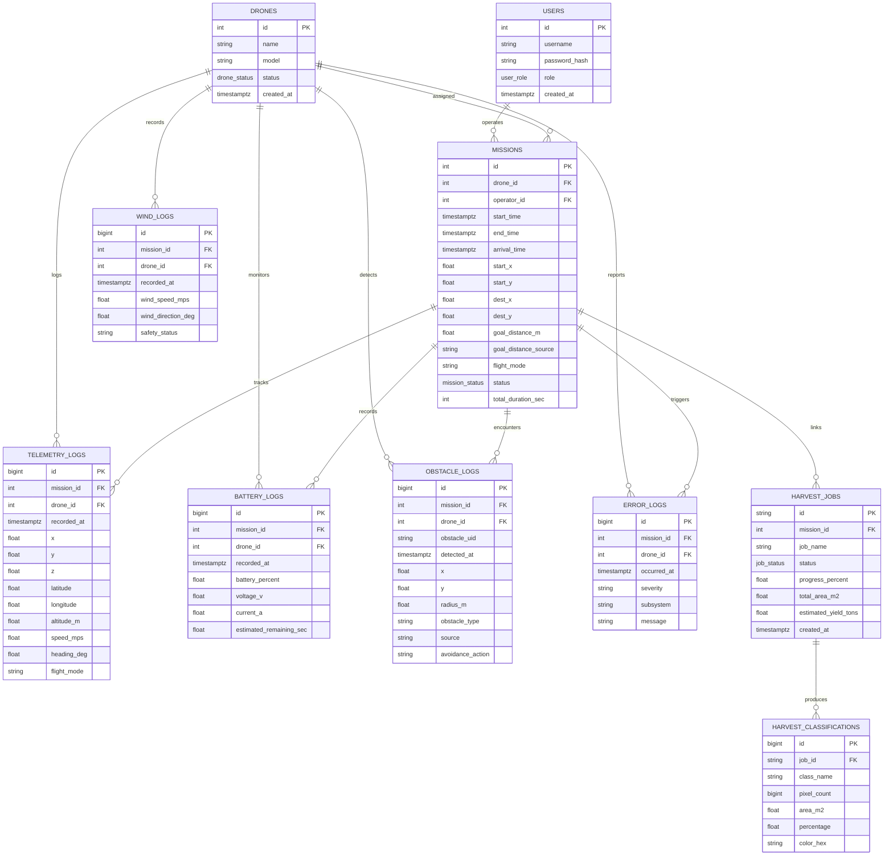
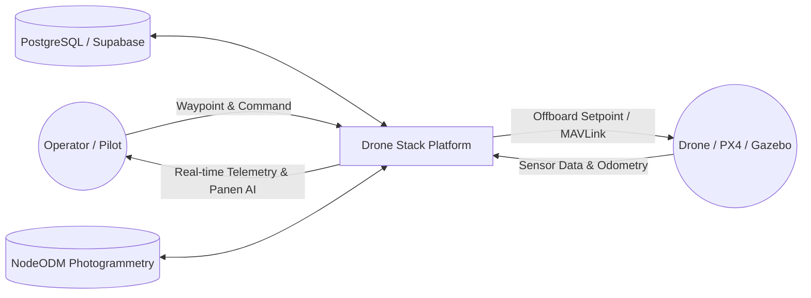
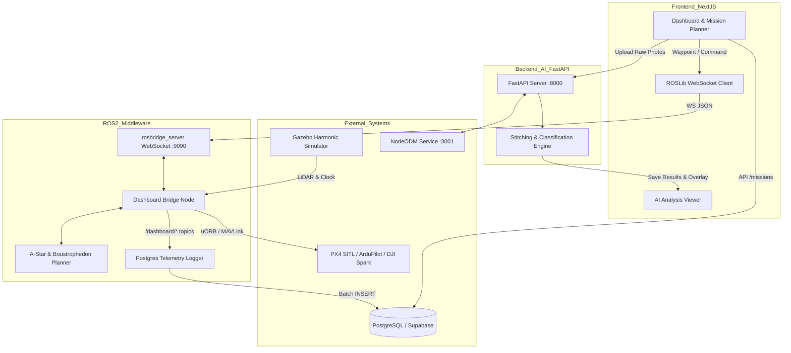

# Dokumentasi Sistem Drone Autonomous & AI Harvest Classification
**Platform: ROS 2 Jazzy | PX4 Autopilot / ArduPilot / DJI Spark | Gazebo Harmonic | Next.js 15 | FastAPI AI | PostgreSQL (Supabase)**

## 1. Arsitektur Teknologi
Sistem ini dirancang untuk monitoring pertanian presisi, navigasi drone otonom, dan analisis kesiapan panen padi secara real-time.
- **Frontend Dashboard:** Next.js 15 (React 19, Leaflet/Protomaps offline basemap, ROSLib WebSocket client)
- **AI Processing Backend:** FastAPI (OpenCV, Rasterio, CLAHE & HSV Segmentation, NodeODM Photogrammetry)
- **Middleware & Robotics:** ROS 2 Jazzy (rclpy, uXRCE-DDS Agent untuk PX4, MAVROS untuk ArduPilot, rosbridge WebSocket suite)
- **Flight Controller & Simulator:** PX4 Autopilot v1.14+, ArduPilot SITL, DJI Spark (Android Mobile SDK), Gazebo Harmonic
- **Database:** PostgreSQL / Supabase (menggunakan pg pool di Next.js dan psycopg2 batch writer di ROS 2)

---

## 2. Entity Relationship Diagram (ERD)
Diagram di bawah menjelaskan struktur data relasional PostgreSQL (`database/supabase_schema.sql`):

---

## 3. Data Flow Diagram (DFD)

### DFD Level 0 (Context Diagram)

### DFD Level 1 (Proses Internal)

---

## 4. Penjelasan Komponen Utama

1. **Dashboard Bridge (`drone_dashboard_bridge`):**
   - Mendukung multi flight stack: PX4 SITL (uXRCE-DDS), ArduPilot (MAVROS), dan DJI Spark (Android App Bridge).
   - Menangani kalkulasi geodesi (WGS84 lat/lon ke ENU lokal meter), deteksi rintangan LiDAR 2D, serta replanning jalur A* secara dinamis.
2. **Postgres Telemetry Logger (`mysql_telemetry_logger.py`):**
   - Merekam telemetri, baterai, estimasi angin, dan rintangan ke database PostgreSQL/Supabase secara asinkron dengan antrean *batch writer* (`executemany`) berkinerja tinggi.
3. **Backend AI (`backend_ai`):**
   - Ekstraksi metadata GeoTIFF menggunakan Rasterio.
   - Segmentasi citra tanaman padi matang (siap panen) vs belum matang menggunakan *color space* HSV adaptif dan CLAHE.
   - Komunikasi otomatis dengan NodeODM untuk menghasilkan orthophoto resolusi tinggi.
4. **Keamanan & Autentikasi:**
   - Autentikasi operator berbasis HMAC-SHA256 *signed cookie* (Edge compatible).
   - Password disimpan dengan algoritma `scrypt`.
   - Pencegahan *path traversal* pada berkas upload dan output geospasial.
