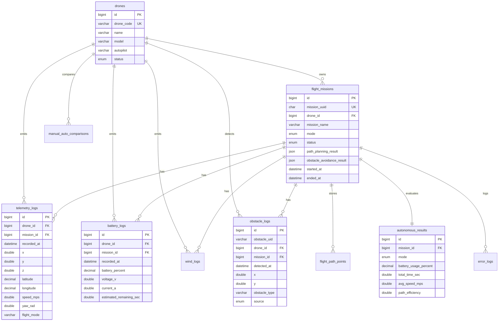

# Integrasi Database Drone ROS 2, PX4, Gazebo, Next.js, PostgreSQL

> **CATATAN MIGRASI (Agustus 2026).** Sistem ini sudah berpindah dari **MySQL**
> ke **PostgreSQL** (agar bisa dihosting di Supabase). Yang berubah:
>
> | Komponen | Sebelum | Sesudah |
> |---|---|---|
> | Skema | `database/drone_schema.sql` | `database/supabase_schema.sql` |
> | Driver frontend | `mysql2` (`lib/mysql.ts`) | `pg` (`lib/db.ts`) |
> | Driver ROS 2 | `mysql-connector` / `PyMySQL` | `psycopg2` |
> | Port default | 3306 | 5432 |
> | Placeholder SQL | `?` | `$1, $2, ...` |
>
> Sebagian bab konseptual di bawah masih memakai istilah "MySQL"; isinya tetap
> berlaku karena bersifat umum (indeks, retensi, batching), hanya nama produknya
> yang berbeda. Bab 6 & 7 (setup & environment) sudah diperbarui.

Dokumen ini mendesain backend database yang ringan, stabil, dan realistis untuk dashboard drone autonomous. Prinsip utamanya: telemetry realtime tidak boleh bergantung pada database untuk kontrol penerbangan. Database dipakai untuk histori, analytics, audit, replay, dan laporan.

## 1. Arsitektur

```text
Gazebo Harmonic / PX4 SITL
        |
        | PX4 topics
        v
ROS 2 Jazzy nodes
        |                         Next.js UI
        | ROS topics              | fetch history/analytics
        v                         v
ROSBridge WebSocket  <---->  Browser dashboard
        |
        | realtime UI stream
        |
ROS 2 MySQL logger
        |
        | batch insert, reconnect
        v
MySQL database  <---->  phpMyAdmin
        ^
        | SQL read/write API
        |
Next.js API routes
```

Alur data:

1. ROS2/PX4/Gazebo mem-publish telemetry ke topic ROS2.
2. Browser Next.js membaca telemetry realtime dari ROSBridge WebSocket untuk tampilan live.
3. Node `mysql_telemetry_logger` subscribe topic ROS2 dan menulis batch ke MySQL.
4. API route Next.js membaca histori dan analytics dari MySQL untuk chart, replay, mission history, dan laporan.
5. phpMyAdmin digunakan untuk administrasi database, inspeksi tabel, backup, dan maintenance.

Kenapa telemetry tidak dikirim dari browser ke database: browser bisa disconnect, throttle, atau ditutup. Logger database harus berjalan dekat ROS2 supaya pencatatan tetap terjadi walaupun UI mati.

## 2. Pilihan Teknologi

Rekomendasi paling ringan untuk project ini:

| Kebutuhan | Pilihan |
| --- | --- |
| Realtime dashboard | ROSBridge WebSocket yang sudah dipakai |
| Penyimpanan telemetry | ROS2 Python logger langsung ke MySQL |
| API histori/analytics UI | Next.js API routes |
| Panel database | phpMyAdmin |
| Cache opsional | Redis hanya jika traffic dashboard banyak |

Jika harus memilih backend terpisah dari daftar Express.js, FastAPI, Flask, NestJS:

| Backend | Cocok untuk | Catatan |
| --- | --- | --- |
| FastAPI | ROS2 integration, async API, WebSocket, Python ecosystem | Pilihan terbaik jika ingin backend terpisah |
| Express.js | API ringan untuk Next.js | Bagus, tetapi ROS2 Python tetap perlu bridge |
| Flask | API sederhana | Kurang ideal untuk realtime dibanding FastAPI |
| NestJS | Backend enterprise besar | Lebih berat dan setup lebih panjang |

Keputusan praktis: gunakan Next.js API routes untuk UI/database, dan ROS2 Python logger untuk ingestion. Tambahkan FastAPI hanya jika nanti butuh service backend mandiri untuk multi-drone/multi-client.

## 3. Data yang Disimpan

Wajib realtime:

| Data | Sumber | Media realtime |
| --- | --- | --- |
| posisi x/y/z, altitude, heading, flight mode | `/odom`, `/dashboard/state` | ROSBridge WebSocket |
| battery percent/voltage/current | `/fmu/out/battery_status`, `/dashboard/state` | ROSBridge WebSocket |
| wind speed/safety | `/fmu/out/wind`, `/dashboard/state` | ROSBridge WebSocket |
| obstacle terdekat dan sensor scan ringkas | `/dashboard/sensor_scan`, `/dashboard/obstacles` | ROSBridge WebSocket |
| mission metrics live | `/dashboard/metrics` | ROSBridge WebSocket |

Wajib disimpan permanen:

| Data | Tabel |
| --- | --- |
| identitas drone | `drones` |
| metadata mission | `flight_missions` |
| telemetry sampling | `telemetry_logs` |
| battery sampling | `battery_logs` |
| planned/actual path penting | `flight_path_points` |
| obstacle detection event | `obstacle_logs` |
| wind sampling/safety event | `wind_logs` |
| error/failsafe/RTH | `error_logs` |
| hasil evaluasi autonomous/manual | `autonomous_results`, `manual_auto_comparisons` |

Cukup cache sementara:

| Data | Saran |
| --- | --- |
| sensor scan LiDAR mentah frekuensi tinggi | Redis/in-memory, jangan simpan semua range ke MySQL |
| posisi live untuk UI | state React/ROSBridge |
| latest telemetry per drone | Redis opsional atau view `latest_drone_telemetry` |
| websocket connection state | in-memory/log event penting saja |

## 4. ERD



Normalisasi sederhana:

1. `drones` menjadi master entitas drone.
2. `flight_missions` menyimpan satu baris per misi.
3. Telemetry, battery, wind, obstacle, dan error dipisah supaya query analytics cepat dan tabel tidak terlalu lebar.
4. `mission_id` boleh `NULL` untuk data saat drone belum berada dalam misi.
5. Payload fleksibel seperti raw ROS message disimpan di kolom `JSON`, tetapi field yang sering dicari tetap dibuat kolom biasa dan diberi index.

## 5. Realtime, REST API, WebSocket, Redis

REST API cocok untuk:

- create/list mission
- ambil histori telemetry
- ambil statistik baterai
- ambil analytics manual vs auto
- simpan event operator

WebSocket/SSE cocok untuk:

- realtime telemetry
- realtime battery chart
- obstacle event live
- mission status live

Di project ini WebSocket sudah ada lewat ROSBridge, jadi jangan menggandakan realtime telemetry lewat database. Gunakan database stream/SSE hanya untuk halaman admin yang ingin melihat data yang benar-benar sudah tersimpan.

Redis tidak wajib untuk satu drone dan satu dashboard. Tambahkan Redis jika:

- dashboard dibuka banyak client
- perlu cache latest state multi-drone
- API analytics mulai berat
- ingin pub/sub backend tanpa langsung membaca MySQL berulang-ulang

## 6. Setup PostgreSQL

Sistem ini sudah BERMIGRASI dari MySQL ke PostgreSQL (lihat catatan di bagian
atas dokumen). Skema yang berlaku: `database/supabase_schema.sql`.

### Opsi A — PostgreSQL lokal

```bash
sudo apt update
sudo apt install -y postgresql postgresql-contrib python3-psycopg2

# PostgreSQL tidak auto-start di WSL2; jalankan tiap kali WSL dinyalakan
sudo service postgresql start

# Set password untuk user postgres
sudo -u postgres psql -c "ALTER USER postgres PASSWORD 'password-anda';"

# Buat database + skema
sudo -u postgres psql -c "CREATE DATABASE drone_ops;"
sudo -u postgres psql -d drone_ops -f database/supabase_schema.sql
```

### Opsi B — Supabase (cloud)

1. Buat project di [supabase.com](https://supabase.com)
2. Buka **SQL Editor**, tempel isi `database/supabase_schema.sql`, klik **Run**
3. Ambil kredensial di **Project Settings → Database → Connection info**

Pakai koneksi **Session pooler** atau **Direct connection** (port `5432`).
JANGAN pakai **Transaction pooler** (port `6543`): mode itu tidak mendukung
prepared statement yang dipakai `psycopg2.executemany()` di logger ROS 2,
sehingga flush batch akan gagal terus-menerus.

## 7. Environment Variables

Frontend Next.js (`frontend/.env.local`):

```env
DB_HOST=127.0.0.1
DB_PORT=5432
DB_USER=postgres
DB_PASSWORD=password-anda
DB_NAME=drone_ops
DB_SSL=false          # true bila memakai Supabase
```

ROS2 logger (lihat `ros2_ws/src/drone_dashboard_bridge/.env.supabase.example`):

```bash
export DRONE_DB_HOST=127.0.0.1
export DRONE_DB_PORT=5432
export DRONE_DB_USER=postgres
export DRONE_DB_PASSWORD=password-anda
export DRONE_DB_NAME=drone_ops
export DRONE_DB_SSLMODE=prefer   # require bila memakai Supabase
export DRONE_DB_DRONE_ID=1
```

Jalankan logger ROS2:

```bash
cd /home/iqball/project/ros2_ws
colcon build --symlink-install --packages-select drone_dashboard_bridge
source install/setup.bash
ros2 launch drone_dashboard_bridge mysql_telemetry_logger.launch.py
```

Jalankan frontend setelah `.env.local` dibuat dari `.env.example`:

```bash
cd /home/iqball/project/frontend
npm install
npm run dev
```

## 8. Optimasi Database

Rekomendasi untuk telemetry besar:

1. Simpan telemetry 2 sampai 10 Hz untuk histori. Jangan simpan 50 sampai 100 Hz kecuali sedang debugging.
2. Batch insert 50 sampai 300 baris per flush.
3. Gunakan index `(drone_id, recorded_at)` dan `(mission_id, recorded_at)`.
4. Query histori selalu pakai filter waktu atau mission.
5. Simpan LiDAR mentah di file/object storage jika perlu, bukan tabel MySQL row-per-range.
6. Archive telemetry lama ke tabel bulanan atau file Parquet/CSV.
7. Buat downsample table jika dashboard sering membuka rentang waktu panjang, misalnya rata-rata per 1 detik atau 10 detik.
8. Untuk produksi besar, gunakan partition per bulan pada tabel `telemetry_logs`, `battery_logs`, dan `wind_logs`.

Contoh partition opsional:

```sql
ALTER TABLE telemetry_logs
PARTITION BY RANGE COLUMNS(recorded_at) (
  PARTITION p202605 VALUES LESS THAN ('2026-06-01'),
  PARTITION p202606 VALUES LESS THAN ('2026-07-01'),
  PARTITION pmax VALUES LESS THAN (MAXVALUE)
);
```

Catatan: partition butuh desain primary/index yang cocok di MySQL. Terapkan setelah data mulai besar.

## 9. Keamanan

1. Pakai user database khusus aplikasi, bukan root.
2. Simpan credential di `.env.local` dan environment ROS2, jangan commit password.
3. Gunakan parameterized query, jangan string SQL gabungan dari input user.
4. Batasi API POST/DELETE dengan session/JWT/API key.
5. Pisahkan role:
   - `admin`: manage database, user, backup
   - `operator`: start/stop mission, lihat dashboard
   - `viewer`: read-only analytics
6. phpMyAdmin jangan dibuka publik tanpa VPN/reverse proxy auth.
7. Log event penting: websocket disconnect, rosbridge error, battery failsafe, obstacle detection failure, RTH trigger.

## 10. Best Practice Penyimpanan Telemetry

Desain yang disarankan:

- Realtime UI: ROSBridge langsung.
- Durable log: ROS2 logger batch ke MySQL.
- Latest state: view/cache.
- Analytics: query agregasi dari tabel histori.
- Replay: pakai `telemetry_logs` dan `flight_path_points`.
- Debug raw: simpan payload JSON hanya secukupnya, bukan semua data sensor frekuensi tinggi.

Target awal yang ringan:

- telemetry: 5 Hz
- battery: 1 Hz
- wind: 1 Hz
- obstacle event: event-based
- error log: event-based
- metrics mission: 1 Hz atau saat mission selesai
