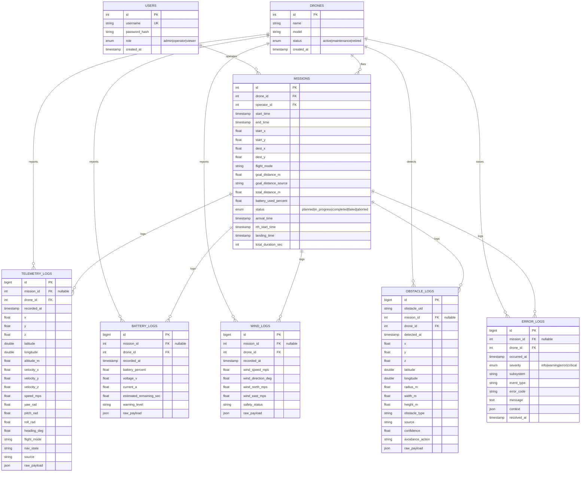

# Dokumentasi Skema Relasi Database: Drone Stack (Modul Drone)

Dokumen ini menggambarkan skema relasional untuk sisi **operasional drone**
saja — akun, inventaris drone, misi penerbangan, dan lima jalur logging
real-time. Modul klasifikasi panen & AI geospasial (`field_boundaries`,
`harvest_jobs`, `harvest_classifications`, `image_metadata`) sengaja
dikeluarkan dari cakupan diagram ini.

Sumber: [`database/drone_schema.sql`](../database/drone_schema.sql) (MySQL,
sumber utama), port 1:1 di
[`database/supabase_schema.sql`](../database/supabase_schema.sql) (PostgreSQL).

## 1. ER Diagram (Mermaid.js)



## 2. Detail Spesifikasi Tabel

### A. Master Data

| Tabel | Kolom Kunci | Constraint | Deskripsi |
| :--- | :--- | :--- | :--- |
| **users** | `id` PK, `username` UNIQUE, `role` ENUM | — | Akun operator/admin dashboard. |
| **drones** | `id` PK, `status` ENUM | — | Inventaris unit drone. |

### B. Transaksi Misi

| Tabel | Relasi | Deskripsi |
| :--- | :--- | :--- |
| **missions** | `drone_id` → drones (CASCADE), `operator_id` → users (SET NULL) | Header sesi penerbangan: titik awal/tujuan, jarak, baterai terpakai, status, timestamp RTH/landing. |

### C. Logging Real-Time (High-Volume)

| Tabel | Relasi | Deskripsi |
| :--- | :--- | :--- |
| **telemetry_logs** | `mission_id` (nullable, CASCADE), `drone_id` (CASCADE) | Posisi, kecepatan, orientasi (indexed by `mission_id, recorded_at`). |
| **battery_logs** | `mission_id`, `drone_id` (CASCADE) | Persentase baterai, tegangan, arus, estimasi sisa waktu. |
| **wind_logs** | `mission_id`, `drone_id` (CASCADE) | Kecepatan & arah angin, status keamanan terbang. |
| **obstacle_logs** | `mission_id`, `drone_id` (CASCADE) | Deteksi rintangan (LiDAR/vision), aksi penghindaran. |
| **error_logs** | `mission_id`, `drone_id` (CASCADE) | Log error/warning subsistem (ROS 2, PX4). |

`mission_id` nullable di semua tabel log ini karena beberapa data (mis.
telemetry saat idle) bisa direkam di luar konteks misi aktif.

## 3. Penjelasan Hubungan (Relationships)

1. **One-to-Many (1:N):**
   - `users → missions`: satu operator bisa menjalankan banyak misi (`operator_id`, `ON DELETE SET NULL` — misi tetap ada walau user dihapus).
   - `drones → missions`: satu drone dipakai di banyak misi (`ON DELETE CASCADE`).
   - `drones/missions → telemetry_logs|battery_logs|wind_logs|obstacle_logs|error_logs`: satu misi/drone menghasilkan ribuan baris log.
2. **Tidak ada relasi Many-to-Many** eksplisit dalam skema ini — relasi N:N potensial (mis. drone bisa dipakai banyak operator) sudah dinormalisasi lewat tabel `missions` sebagai penghubung.

> Modul klasifikasi panen & AI geospasial (`field_boundaries`, `harvest_jobs`,
> `harvest_classifications`, `image_metadata`) didokumentasikan terpisah —
> lihat riwayat sebelumnya di file ini atau `database/drone_schema.sql`
> bagian 4 jika dibutuhkan lagi.

## 4. Cara Regenerasi Diagram

Skema Mermaid di atas adalah "kode"-nya — render di GitHub (otomatis), VS
Code (ekstensi Markdown Preview Mermaid), atau [mermaid.live](https://mermaid.live).
Sumber kebenaran struktur tabel tetap file DDL:

```bash
# MySQL (lokal)
mysql -u root -p < database/drone_schema.sql

# PostgreSQL/Supabase
psql "$SUPABASE_DB_URL" -f database/supabase_schema.sql
```
